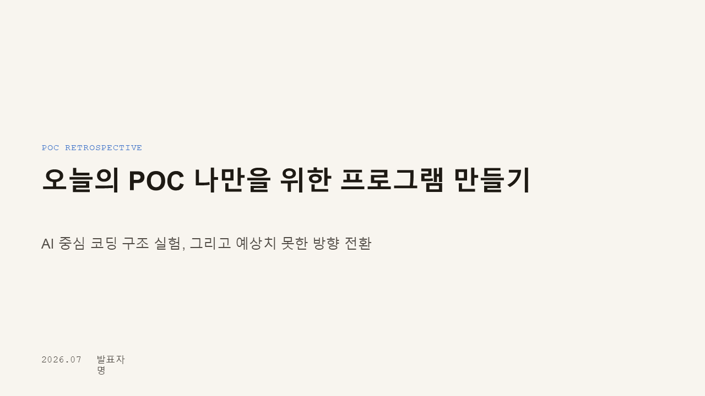
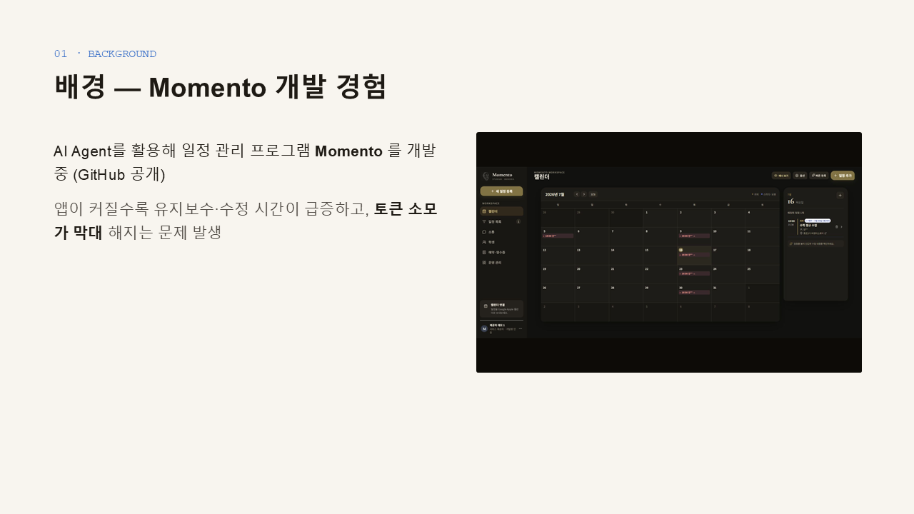
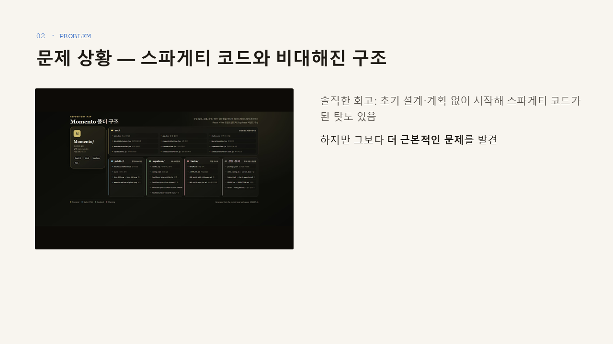
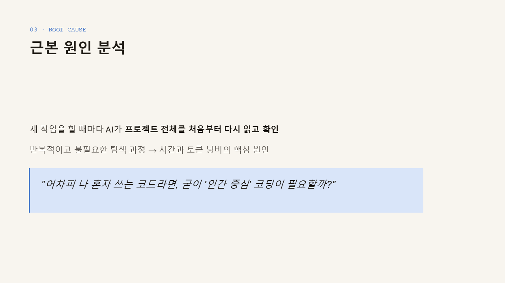
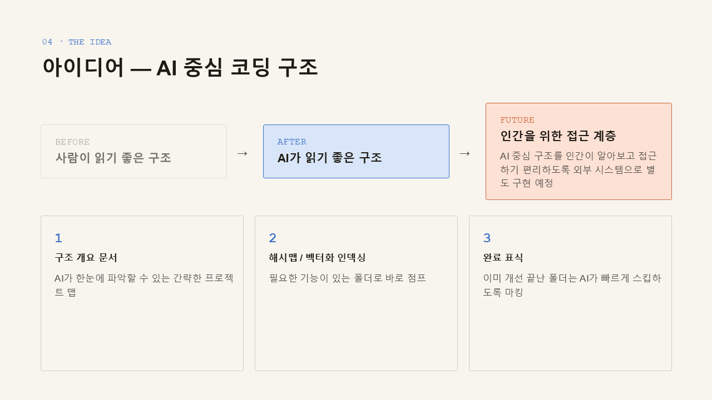
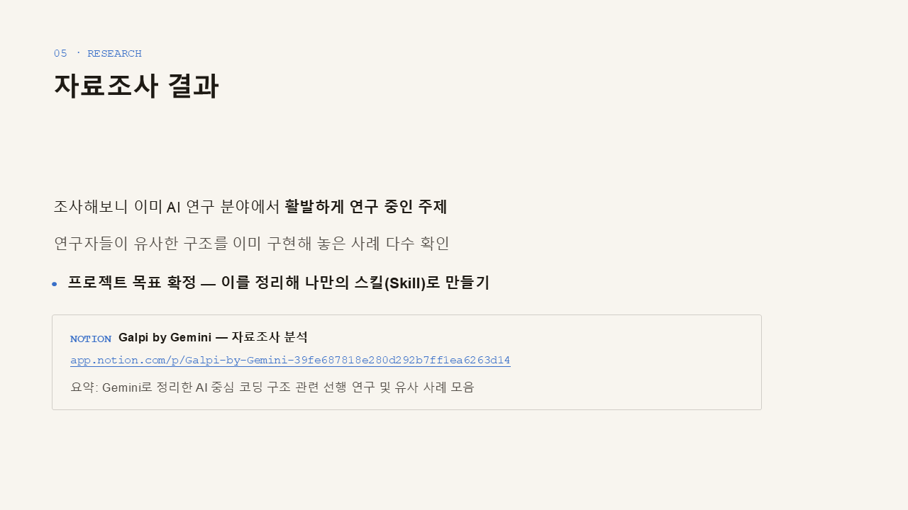
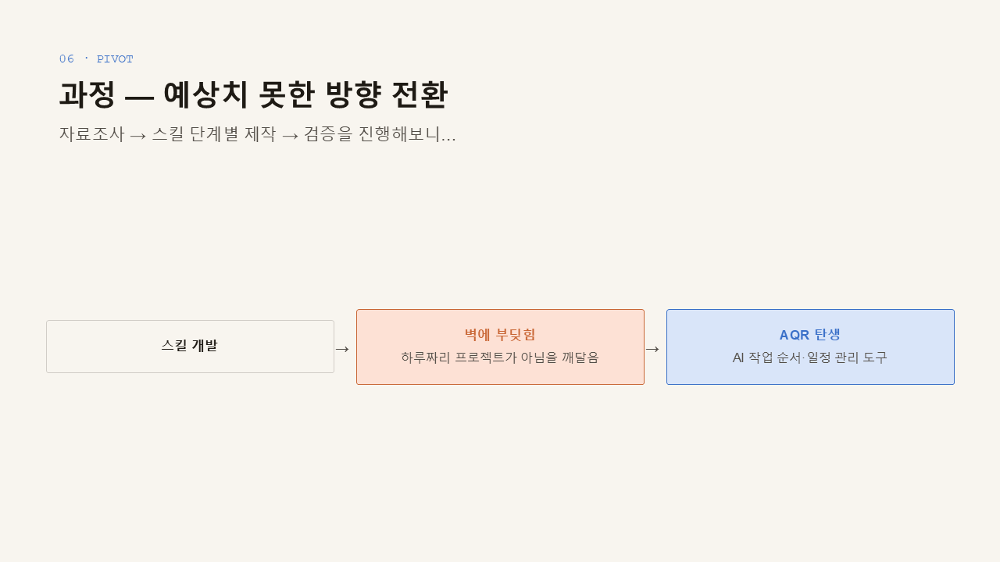
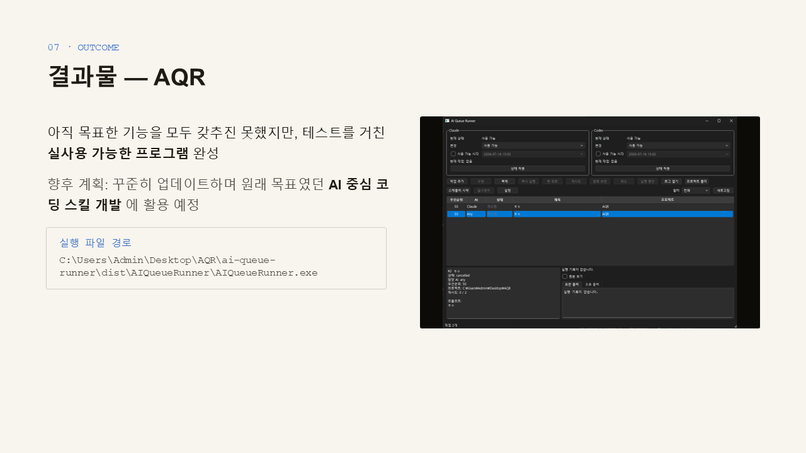
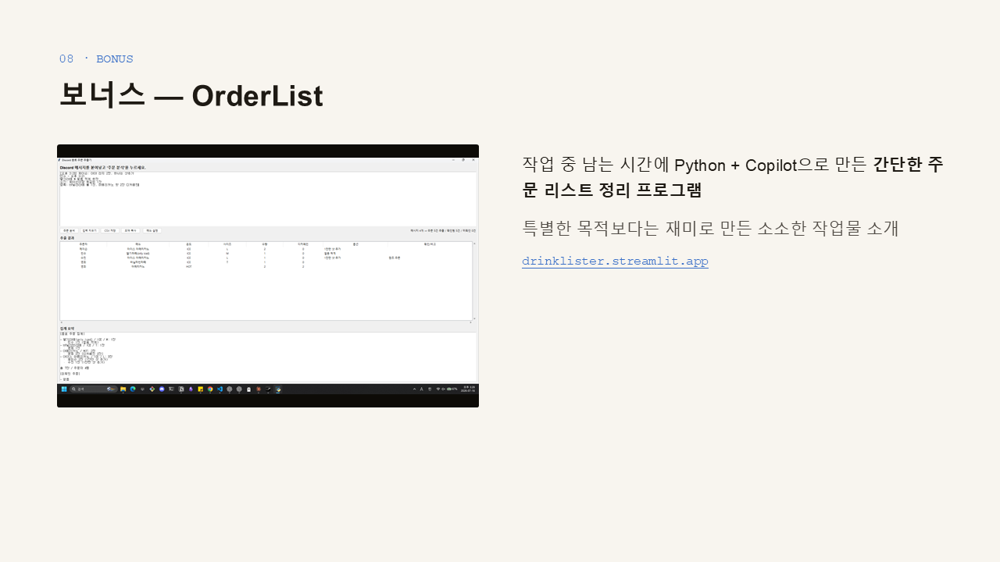

# AQR

AI Queue Runner의 저장소 진입점입니다.

- [사용법과 현재 상태](ai-queue-runner/README.md)
- [요구사항과 개발 계획](ai-queue-runner/docs/PLAN.md)
- [아키텍처](ai-queue-runner/docs/ARCHITECTURE.md)
- [AI 운영 가이드](ai-queue-runner/docs/AI_GUIDE.md)

## POC 회고 발표 자료

AQR이 만들어진 배경과 과정을 담은 발표 자료입니다. 원본: [AQR.pptx](AQR.pptx)

