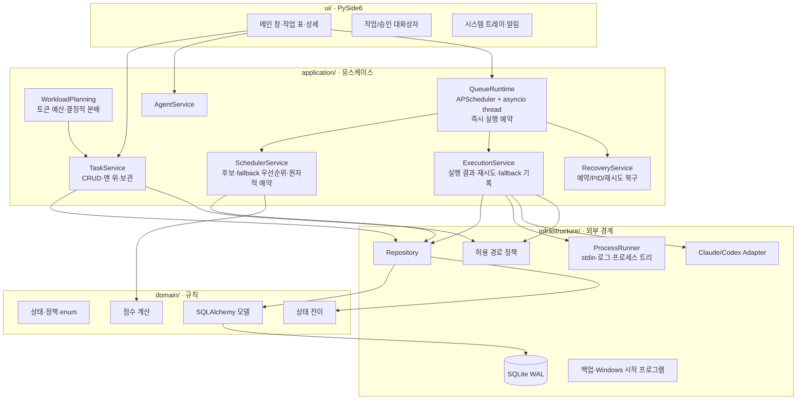
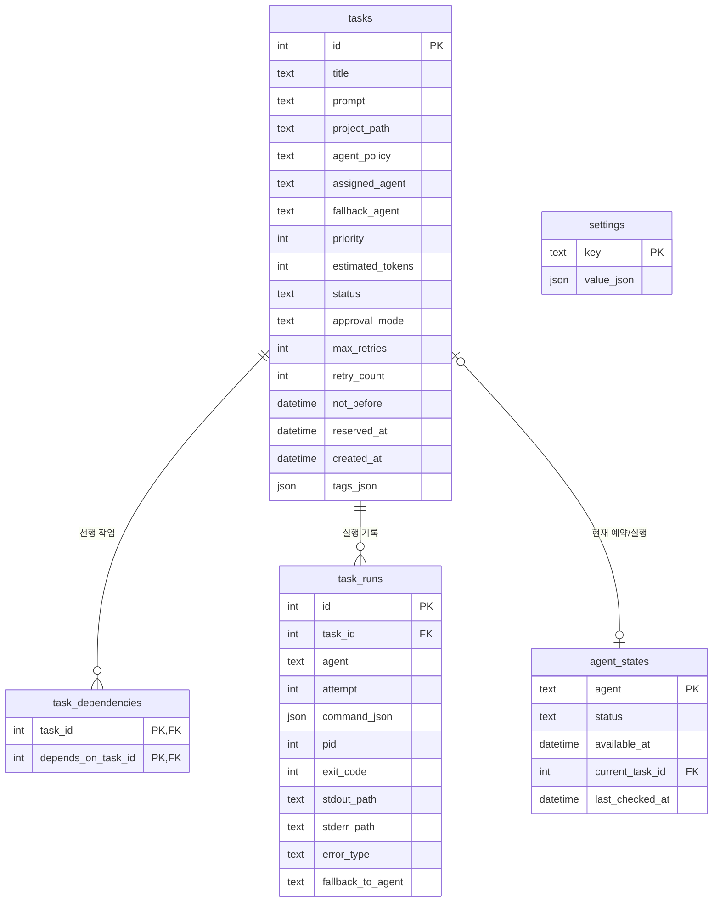
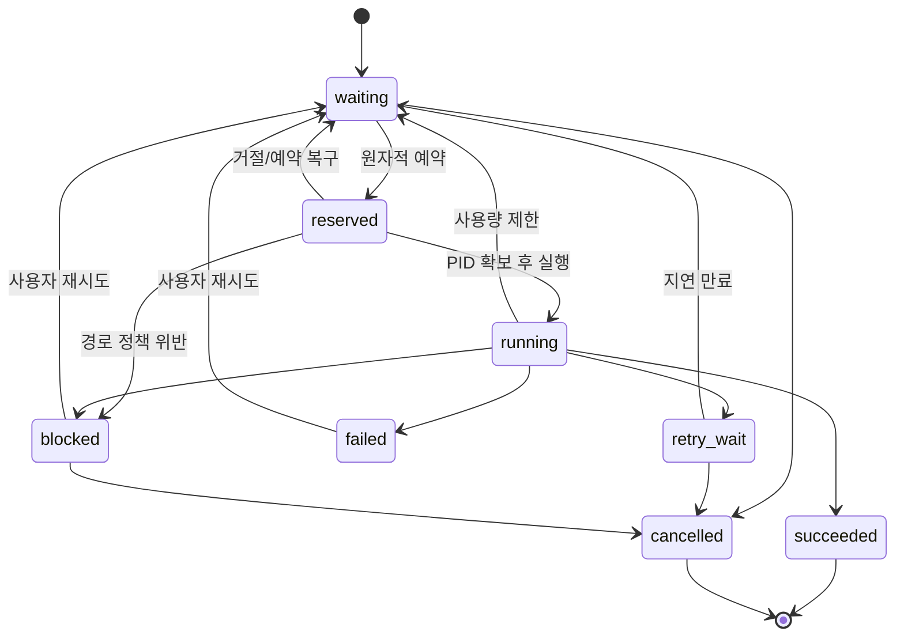
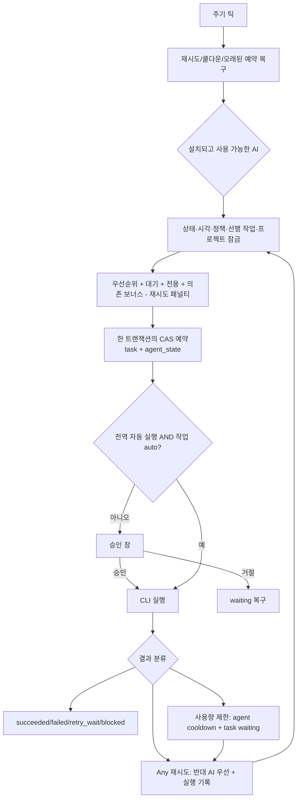

# 아키텍처 개요

이 문서는 AI Queue Runner v0.1의 구현 구조와 핵심 불변식을 설명합니다. 테이블·상태·모듈 경계가 바뀌면 같은 변경에서 이 문서도 갱신합니다.

## 1. 계층과 실행 흐름

의존 방향은 UI → application → domain/infrastructure입니다. UI는 DB 세션이나 프로세스를 직접 다루지 않습니다. 스케줄러 틱과 각 CLI 실행은 별도 SQLAlchemy 세션을 소유하며 UI 스레드를 막지 않습니다.

## 2. 데이터 모델

DB 시간은 SQLite의 제약 때문에 naive UTC로 저장하고 UI 경계에서만 로컬 시간으로 바꿉니다. enum은 읽을 수 있는 문자열 값으로 저장됩니다.
스키마 v2는 기존 v1 DB의 `tasks`에 `estimated_tokens`를 기본값 0으로 추가하며,
일반 작업의 0은 추정치 미지정을 뜻합니다. 스키마 v3는 `tasks.fallback_agent`와
`task_runs.fallback_to_agent`를 추가해 현재 우선 대상과 에이전트 전환 이력을 보존합니다.

## 3. 작업 상태 전이

`domain/transitions.py`가 허용 전이의 단일 기준이며, 상태 변경은 `TaskRepository.set_status()`를 통해서만 수행합니다.

실행 프로세스가 시작되면 PID와 OS 프로세스 생성 시각을 즉시 커밋합니다. 비정상 종료 뒤에는 두 값이 모두 일치할 때만 같은 프로세스로 인정합니다. PID 재사용 또는 생성 시각 확인 실패 시에는 무관한 프로세스를 종료하지 않고 자동 복구를 중단합니다.

## 4. 예약과 실행

예약은 `WHERE status='waiting'`, 동일 프로젝트의 `reserved/running` 행이 없다는 `NOT EXISTS`, `agent_states.current_task_id IS NULL` 조건을 둔 compare-and-swap UPDATE입니다. 두 에이전트가 같은 `any` 작업 또는 같은 프로젝트의 서로 다른 작업을 동시에 선택해도 한쪽만 성공합니다. `current_task_id`는 실행 시작이 아니라 예약 시점에 잡아 한 에이전트가 둘 이상의 작업을 보유하지 못하게 합니다.

`any` 작업의 재시도 가능 실패가 설정 임계값(기본 1회)에 도달하면 `ExecutionService`가
반대 AI를 `fallback_agent`로 기록합니다. `SchedulerService`는 그 AI가 설치되고 현재 사용
가능할 때 이전 AI의 후보에서 작업을 제외하므로 틱 순서와 무관하게 결정적으로 전환합니다.
대상 AI가 쿨다운·비활성·미설치이면 기존 AI도 다시 후보가 될 수 있어 작업이 영구 고정되지
않습니다. 사용량 제한은 `retry_count`를 올리지 않고 즉시 같은 우선순위를 설정합니다.
전용 정책과 `fallback_enabled=false`에서는 이 규칙을 적용하지 않습니다.

## 5. CLI 안전 경계

- 프로젝트 경로는 절대 경로·실재 디렉터리여야 하고 `allowed_project_roots` 아래여야 합니다.
- 빈 허용 루트는 모든 실행을 차단합니다.
- Claude는 `--permission-mode auto --no-session-persistence`, Codex는 `--sandbox workspace-write --ask-for-approval never --ephemeral` 조합을 사용합니다.
- 사용자 프롬프트는 표준 입력으로 보내며 `task_runs.command_json`에 중복 저장하지 않습니다.
- stdout/stderr는 파일로 스트리밍해 긴 출력으로 메모리가 증가하지 않게 합니다.
- 취소·타임아웃·복구는 `psutil`로 전체 하위 프로세스 트리를 종료합니다.
- 복구 종료 직전에도 예상 생성 시각을 다시 비교해 PID 검증과 종료 사이의 재사용을 막습니다.
- Claude의 구조화 `rate_limit_event`는 `rate_limit_info.status=allowed`이면 정상으로 처리하고, 일반 제한 문자열은 비정상 종료에서만 보조 분류합니다.
- `plan-batch`는 전용 작업을 먼저 예산에 반영하고 큰 `any` 작업부터 예상 사용률이 낮은 에이전트에 결정적으로 배치합니다.
- 계획된 작업은 결정된 전용 정책으로 바꾼 뒤 `TaskService.create_batch()`의 단일 트랜잭션으로 저장합니다.

## 6. 주요 파일

| 경로 | 역할 |
|---|---|
| `application/runtime.py` | APScheduler 틱, asyncio 실행 루프, 승인·거절·중단 |
| `application/task_service.py` | 작업 CRUD·복제·재시도·맨 위 이동·완료 보관·의존성 검증 |
| `application/workload_planning.py` | 명시적 토큰 예산 검증·결정적 Claude/Codex 분배 |
| `application/agent_service.py` | 에이전트 상태·사용 가능 시각·쿨다운 승격 |
| `application/scheduler_service.py` | 후보 필터·fallback 우선순위·점수·CAS 예약 |
| `application/execution_service.py` | CLI 실행, 여섯 결과 경로, fallback 결정·이력 기록 |
| `application/recovery_service.py` | 오래된 예약·재시도·고아 PID 복구 |
| `infrastructure/adapters/` | 설치 확인, 안전한 명령 구성, 오류 분류 |
| `infrastructure/process_runner.py` | 비동기 subprocess, stdin, 로그, 취소, 타임아웃 |
| `infrastructure/path_policy.py` | 프로젝트 허용 루트 검증 |
| `infrastructure/backup.py` | SQLite 온라인 백업과 무결성 검사 |
| `config/exporter.py` | 유효 설정의 결정적 TOML 내보내기 |
| `infrastructure/windows_startup.py` | HKCU Run 시작 프로그램 등록 |
| `ui/` | 메인 창, 작업/승인 UI, 로그, 트레이 |
| `scripts/build_windows.ps1` | PyInstaller onedir 빌드·버전 스모크 |
| `scripts/run_soak.ps1` | 20개 작업·재시작 소크 반복 |

## 7. 복구와 운영

- SQLite 연결마다 foreign key와 WAL을 활성화합니다.
- 예약 타임아웃, 재시도 승격, 에이전트 쿨다운 해제는 매 틱 먼저 수행합니다.
- 시작 시 `running` 작업의 마지막 PID를 검사하고 대기 복구 또는 실패 처리를 사용자에게 묻습니다.
- 온라인 백업은 SQLite backup API를 쓰고 결과에 `PRAGMA integrity_check`를 실행합니다.
- 설정 내보내기는 검증과 상대 경로 해석을 마친 유효 값을 기록합니다.
- Windows 시작 프로그램은 현재 사용자 범위의 HKCU Run 키만 사용하며 명시적 옵션입니다.
- 완료 보관은 v1의 고정된 8개 상태를 늘리지 않고 예약된 내부 태그로 저장하며, 사용자 태그·복제 작업에는 노출되지 않습니다.
