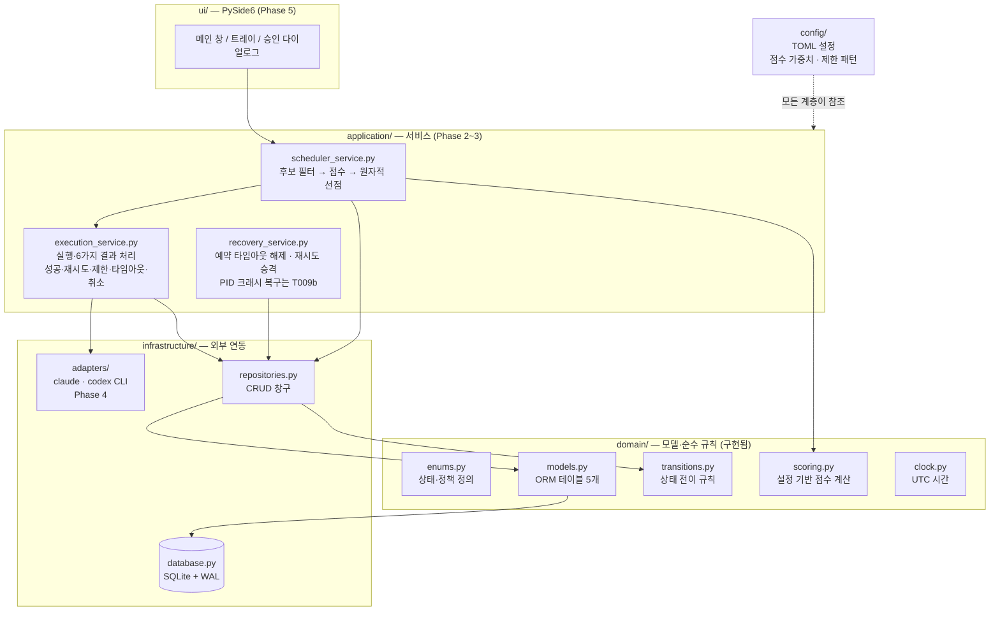
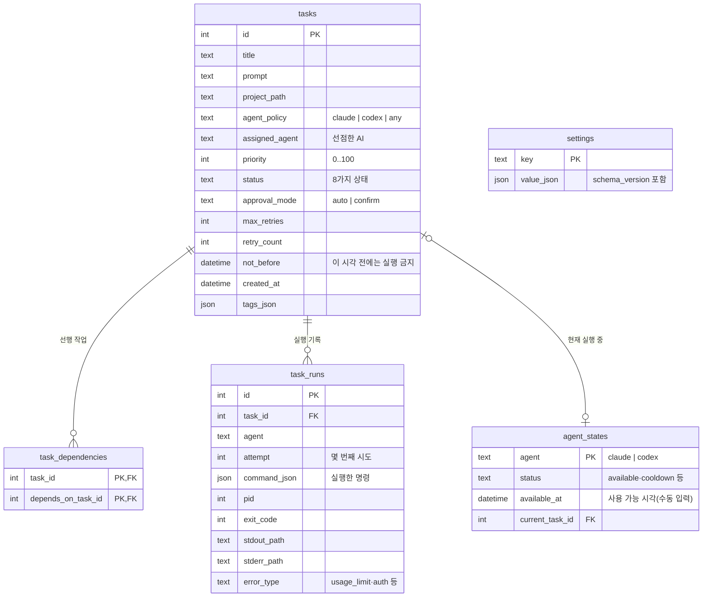
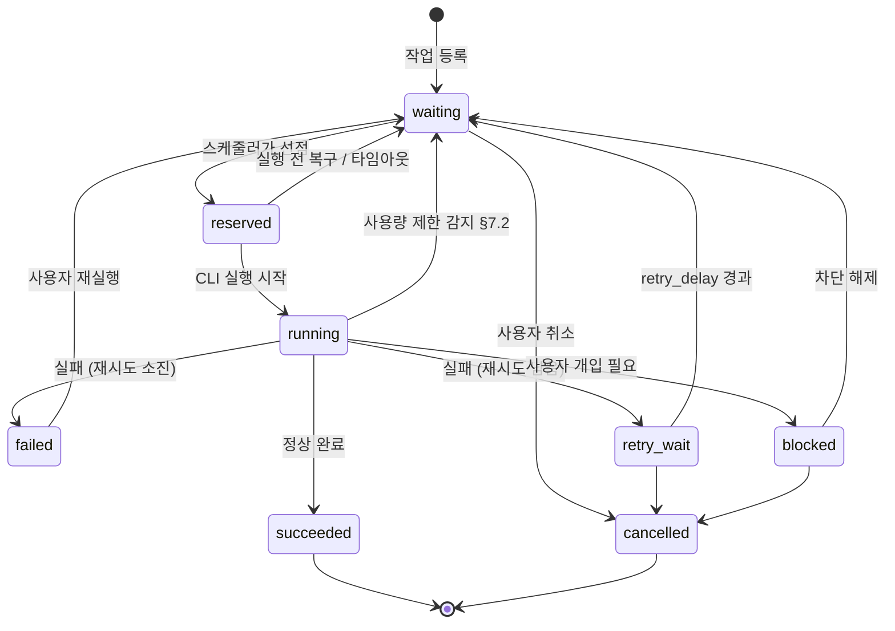
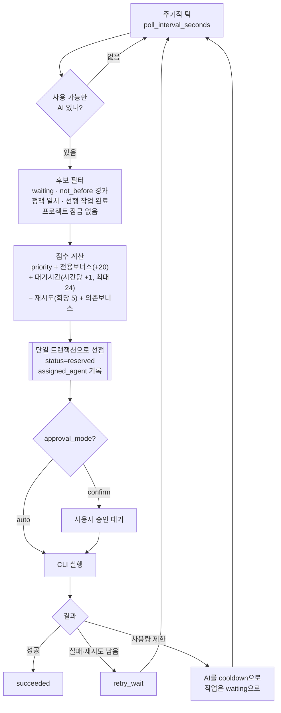

# 아키텍처 도식

사람이 코드 전체를 읽지 않고 구조를 파악하기 위한 문서입니다.
테이블·상태·모듈이 바뀌면 같은 작업 안에서 이 문서의 도식도 갱신합니다(AGENTS.md 규칙).

> 도식은 Mermaid로 작성되어 GitHub/VS Code 미리보기에서 그림으로 렌더링됩니다.

## 1. 전체 구조 (계층)

의존 방향은 항상 **UI → application → domain/infrastructure** 한쪽입니다.
domain은 아무것도 import하지 않는 순수 로직 계층입니다.

## 2. 데이터 모델 (ERD)

## 3. 작업 상태 전이

`domain/transitions.py`가 이 그림 그대로를 코드로 강제합니다.
그림에 없는 전이는 `InvalidTransitionError`가 발생합니다.

## 4. 스케줄링 흐름

핵심 안전 규칙: **선점(reserve)은 하나의 DB 트랜잭션** 안에서 이루어집니다.
구현은 CAS(compare-and-swap) UPDATE 방식 — `WHERE status='waiting'` 조건이 붙은
UPDATE는 경쟁 시 한쪽만 성공하므로 같은 `any` 작업이 두 AI에 배정될 수 없고,
진 쪽은 자동으로 재선택합니다. 선점 시 `agent_states.current_task_id`도 함께
기록되어 한 AI가 두 작업을 동시에 쥘 수 없습니다. 타임아웃을 넘긴 예약은
`recovery_service`가 waiting으로 되돌립니다.

## 5. 파일 지도

| 경로 | 역할 | 상태 |
|---|---|---|
| `domain/enums.py` | 모든 상태·정책 enum | ✅ Phase 1 |
| `domain/transitions.py` | 상태 전이 규칙 (위 3번 그림) | ✅ Phase 1 |
| `domain/models.py` | DB 테이블 5개 (위 2번 그림) | ✅ Phase 1 |
| `domain/clock.py` | UTC 시간 헬퍼 (테스트에서 시간 조작용) | ✅ Phase 1 |
| `domain/scoring.py` | 우선순위·대기·재시도·의존성 기반 점수 계산 | ✅ Phase 2 |
| `infrastructure/database.py` | 엔진 생성, FK/WAL PRAGMA, 스키마 버전 | ✅ Phase 1 |
| `infrastructure/process_runner.py` | 서브프로세스 실행 (로그 스트리밍·타임아웃·취소) | ✅ Phase 3 |
| `infrastructure/repositories.py` | CRUD 창구 — 상태 변경은 `set_status()`만 사용 | ✅ Phase 1 |
| `config/defaults.py` | 모든 튜닝값 (점수 가중치, 제한 패턴) | ✅ Phase 0 |
| `config/loader.py` | TOML 로드 + 검증 | ✅ Phase 0 |
| `infrastructure/logging_config.py` | 콘솔 + 회전 파일 로그 | ✅ Phase 0 |
| `application/scheduler_service.py` | 후보 필터·점수·동점 처리 + CAS 원자적 선점 | ✅ Phase 2 |
| `application/recovery_service.py` | 예약 타임아웃 해제 + retry_wait→waiting 승격 | ✅ Phase 2~3 |
| `application/execution_service.py` | 예약된 작업 실행, 성공/실패/재시도/제한/취소 처리 | ✅ Phase 3 |
| `infrastructure/adapters/base.py` | AgentAdapter 프로토콜 (명령 생성 + 오류 분류) | ✅ Phase 3 |
| `infrastructure/adapters/` | Claude/Codex CLI 어댑터 | ⬜ Phase 4 |
| `ui/` | PySide6 창·트레이 | ⬜ Phase 5 |
