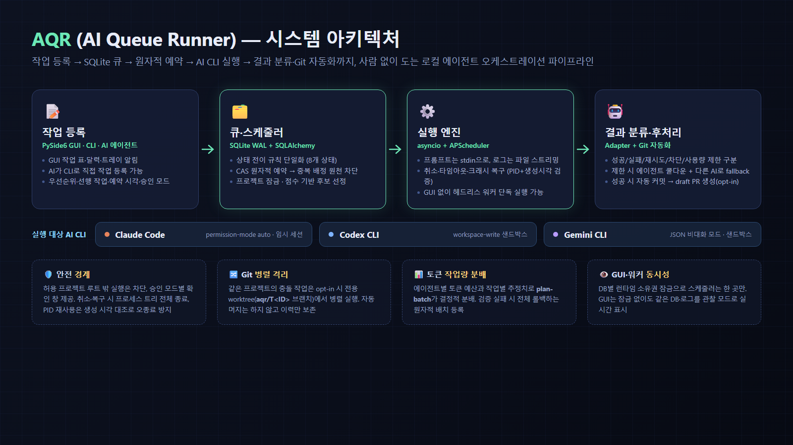
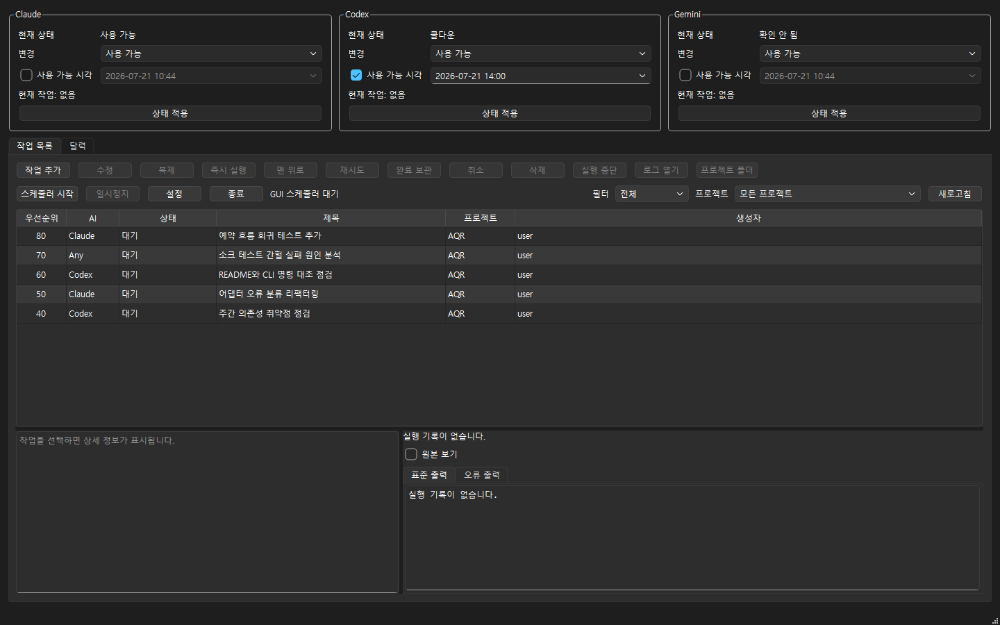

# [바이브코딩 해커톤 대회 결과물]

* **프로젝트 이름** : AQR (AI Queue Runner)
* **해결하고자 한 문제 (주제)** : Claude Code·Codex·Gemini 같은 AI 코딩 에이전트에게 맡길 작업을 큐에 등록해두면, 자는 동안에도 우선순위·에이전트 상태·사용량 제한에 맞춰 사람 없이 안전하게 자동 실행해주는 로컬 매니저 만들기
* **사용한 기술 스택** : Python, PySide6(Qt), SQLite(SQLAlchemy), asyncio, APScheduler
* **GitHub 링크** : https://github.com/jasonwpgml/AQR

## 시연 이미지

### 1. 프로젝트 요약

### 2. 시스템 아키텍처

### 3. 실행 화면

에이전트 상태 패널(Claude 사용 가능 · Codex 쿨다운 · Gemini 미확인)과 우선순위 순으로 정렬된 대기 작업 큐:

